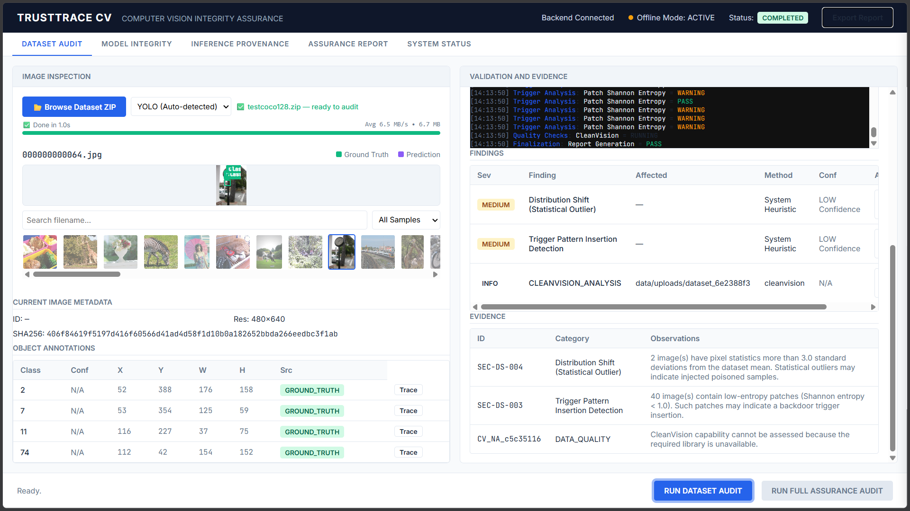
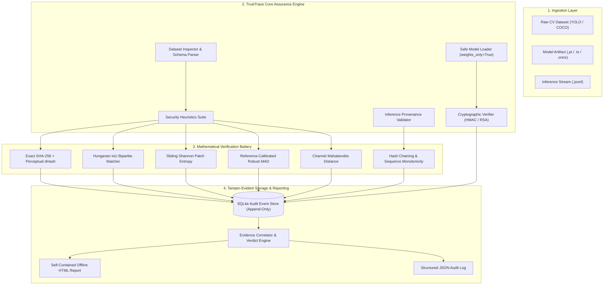

<div align="center">

# 🛡️ TrustTrace CV

### Deep Learning Integrity, Cryptographic Provenance & Adversarial Assurance Toolkit for Computer Vision Pipelines

[](https://www.python.org/)
[](https://pytorch.org/)
[](https://onnxruntime.ai/)
[](https://fastapi.tiangolo.com/)
[](https://www.sqlite.org/)
[](https://docs.pytest.org/)
[](LICENSE)

<br/>

**[Overview](#-overview)** •
**[Key Features](#-key-features)** •
**[Ecosystem Comparison](#-how-it-compares)** •
**[System Architecture](#-system-architecture)** •
**[Empirical Benchmarks](#-empirical-benchmarks--scientific-validation)** •
**[Quick Start](#-quick-start-guide)** •
**[Python API](#-python-api-examples)** •
**[CLI Reference](#-command-line-interface-cli)** •
**[REST API](#-rest-api-reference)** •
**[Documentation](#-documentation-index)**

<br/>



*The TrustTrace CV interactive dashboard: Real-time mathematical audit traces, cryptographic verification, and offline forensic report generation.*

</div>

<br/>

---

## 📖 Overview

**TrustTrace CV** is an offline-first, model-agnostic assurance and cryptographic provenance toolkit designed specifically for Computer Vision (CV) pipelines. Modern computer vision systems deployed in safety-critical domains are vulnerable to **data poisoning**, **Trojan backdoor insertion**, **model substitution**, and **silent inference log manipulation**.

TrustTrace CV provides verifiable cryptographic integrity checking and statistical anomaly heuristics across three core stages of the computer vision lifecycle:
* **Dataset Integrity**: Detecting exact byte flooding, perceptual near-duplicates (dHash), label and bounding box perturbations (Hungarian IoU matching), localized solid backdoor triggers (sliding Shannon patch entropy), and reference-calibrated distribution shifts (MAD and Mahalanobis distance).
* **Model Integrity**: Verifying model artifact digests against signed cryptographic manifests (HMAC-SHA256 or RSA-2048) and safely inspecting model architectures without arbitrary unpickling (`weights_only=True`).
* **Inference Provenance**: Signing prediction telemetry with HMAC-SHA256, strictly monotonic sequence counters, and anti-replay nonces stored in a tamper-evident SQLite forward hash chain.
* **Forensic Reporting & API**: Emitting self-contained offline HTML audit reports with embedded visualizations, served by a FastAPI backend and browser dashboard.

---

## ✨ Key Features

### 📁 1. Dataset Integrity & Poisoning Defense
* **Exact Duplicate Flooding (`SEC-DS-001`)**: High-throughput cryptographic SHA-256 byte hashing to flag exact sample duplication and train/test leakage.
* **Perceptual Near-Duplicate Detection (`SEC-DS-001b`)**: 64-bit Difference Hash (dHash) with calibrated Hamming distance filtering ($\le 8$) to identify recompressed (JPEG quality shifts) and resized near-duplicates.
* **Label Flipping & BBox Integrity (`SEC-DS-002`)**: Optimal bipartite matching via the **Hungarian algorithm (Kuhn-Munkres)** with class affinity tie-breaking ($IoU \ge 0.50$). Dissected into `CLASS_CHANGE`, `BBOX_MODIFIED`, `MISSING_ANNOTATION`, and `ADDITIONAL_ANNOTATION`. Guaranteed 0 false positives under annotation reordering.
* **Backdoor Trigger Pattern Detection (`SEC-DS-003`)**: Sliding-window Shannon patch entropy analysis ($16 \times 16$ patches) detecting low-entropy synthetic overlays, BadNets triggers, and solid pixel watermarks.
* **Data Poisoning & Distribution Shift (`SEC-DS-004`)**: Robust, reference-calibrated Modified Z-scores using **Median and Median Absolute Deviation (MAD)** across color spaces, resisting heavy outlier masking.
* **Out-of-Distribution (OOD) Detection (`SEC-DS-005`)**: Reference-calibrated channel-covariance **Mahalanobis Distance** identifying statistical domain shifts and corruptions.
* **Structural Schema Validation**: Offline parsers for **YOLO (v5/v8)** text coordinates and **COCO 1.0 JSON** schemas.

### 🧠 2. Model Integrity & Checkpoint Security
* **Cryptographic Manifest Hashing**: SHA-256 digest calculation for model weights, architectures, and associated assets.
* **Dual-Scheme Signature Verification**:
  * **Symmetric HMAC-SHA256**: Timing-attack safe digest verification (`hmac.compare_digest`) using shared secret keys.
  * **Asymmetric RSA-2048 PKCS#1 v1.5**: Public-key verification using standard PEM public keys.
* **Safe Deserialization (`weights_only=True`)**: Strict PyTorch unpickling protection preventing arbitrary code execution from untrusted checkpoint files.
* **Multi-Format Support**: Native structural introspection for **PyTorch (`.pt`, `.pth`)**, **TorchScript packages**, and **ONNX graphs (`.onnx`)**.
* **Model Substitution Protection**: Deterministic parameter count and tensor structure verification preventing unauthorized model swaps.

### ⛓️ 3. Tamper-Evident Inference Provenance Ledger
* **Forward Cryptographic Hash Chain**: Every logged inference record is cryptographically linked to the previous record (`previous_event_hash` $\to$ current record hash), forming a tamper-evident forward chain in SQLite.
* **Strict Monotonic Sequencing**: Enforces gapless, strictly increasing `sequence_number` counters to detect dropped, injected, or reordered frames.
* **Anti-Replay Nonce Verification**: 16-byte random nonces (`os.urandom(16).hex()`) prevent replay attacks from recorded telemetry streams.
* **Canonical JSON Serialization**: Deterministic key sorting (`sort_keys=True`) and compact whitespace elimination (`separators=(',', ':')`) preventing byte-level hashing ambiguities.

### 📊 4. Full-Stack Assurance & Forensic Reporting
* **Interactive Forensic Reports**: Generates self-contained, offline HTML audit reports with base64-embedded anomaly visualizations and complete audit logs.
* **Live REST API & Dashboard**: Asynchronous FastAPI service paired with a lightweight web UI providing real-time mathematical audit traces.
* **Boundary Adapter Architecture**: Explicit compatibility adapters for **Cleanlab**, **CleanVision**, **IBM ART**, **BackdoorBench**, **TrojAI**, **in-toto**, and **Cosign** that degrade honestly to `NOT_ASSESSED` in offline air-gapped environments without generating simulated passes.

---

## ⚖️ How It Compares

| Capability | TrustTrace CV | Deepchecks (Vision) | CleanVision | IBM ART | Sigstore / Cosign |
| :--- | :---: | :---: | :---: | :---: | :---: |
| **Primary Scope** | **Cryptographic Provenance & Statistical CV Integrity** | ML Validation & Testing | Visual Data Quality | Adversarial Attacks & Robustness | Container / Artifact Signing |
| **Cryptographic Provenance** | ✅ **Native (HMAC + RSA forward hash chain)** | ❌ None | ❌ None | ❌ None | ✅ Signature only |
| **Hungarian BBox & Label Audit** | ✅ **Optimal Bipartite Matching** | ⚠️ Generic Heuristics | ❌ None | ⚠️ Indirect | ❌ None |
| **Patch-Level Entropy Scans** | ✅ **Native ($16 \times 16$ Shannon Entropy)** | ❌ None | ❌ None | ⚠️ Complex Defense | ❌ None |
| **Perceptual Near-Duplicates** | ✅ **64-bit dHash (Hamming Dist $\le 8$)** | ⚠️ Basic Duplicates | ✅ Visual Near-Dup | ❌ None | ❌ None |
| **Monotonic Inference Ledger** | ✅ **Gapless Sequence + Anti-Replay** | ❌ None | ❌ None | ❌ None | ❌ None |
| **Air-Gapped / Offline Native** | ✅ **100% Offline (Zero Cloud Calls)** | ⚠️ Requires Dependencies | ✅ Offline | ✅ Offline | ⚠️ Needs Rekor/Fulcio |
| **Safe Deserialization** | ✅ **Enforced (`weights_only=True`)** | ⚠️ Standard Pickling | ❌ N/A | ⚠️ Standard Loading | ❌ N/A |
| **Self-Contained Offline Reports** | ✅ **Interactive HTML (Base64 embed)** | ⚠️ HTML / Cloud | ❌ None | ❌ None | ❌ None |

---

## 🏗️ System Architecture

TrustTrace CV enforces an end-to-end pipeline verifying assets at every phase of the vision lifecycle:



---

## 🔬 Empirical Benchmarks & Scientific Validation

TrustTrace CV enforces zero experimental leakage: thresholds are selected strictly on a dedicated **Calibration Split** (25 synthetic images) and evaluated on an independent **Evaluation Benchmark Split** (130 evaluation samples, 30 clean reference baselines).

The table below reflects empirical metrics measured directly from our reproducible test harness (`scripts/run_benchmark.py`), with results saved to `reports/benchmark_results.json`:

| Assurance Module | Target Threat Scenario | Latency (ms) | Peak RAM | Precision | Recall | F1 Score | AUROC | AUPR | FPR |
| :--- | :--- | :---: | :---: | :---: | :---: | :---: | :---: | :---: | :---: |
| **Exact Duplicate (SHA-256)** | Adversarial Dataset Flooding | **0.25 ms** | 13.5 KB | 0.500 | 1.000 | 0.667 | — | — | 0.111 |
| **Perceptual dHash (Hamming $\le 8$)** | Recompression & Resizing Evasion | 112.05 ms | 126.8 KB | 0.563 | 0.900 | 0.692 | 0.742 | 0.578 | 0.467 |
| **Hungarian IoU Label Matcher** | Label Flipping & BBox Alteration | **14.96 ms** | 26.7 KB | **1.000** | **1.000** | **1.000** | — | — | **0.000** |
| **Sliding Shannon Patch Entropy** | Solid Patch Backdoor Triggers (BadNets) | 246.25 ms | 319.0 KB | **1.000** | 0.400 | 0.571 | 0.870 | 0.864 | **0.000** |
| **Ref-Calibrated Robust MAD** | Feature Poisoning & Color Shift | 5.08 ms | 74.6 KB | 0.714 | **1.000** | 0.833 | **0.987** | **0.977** | 0.267 |
| **Ref-Calibrated Mahalanobis** | Statistical Out-of-Distribution (OOD) | 3.29 ms | 23.2 KB | 0.692 | 0.600 | 0.643 | 0.796 | 0.783 | 0.133 |

> [!NOTE]
> * **Dataset Composition & Split Strategy**: Evaluated using `scripts/run_benchmark.py` across an independent **Evaluation Benchmark Split** (130 samples) calibrated against 30 clean reference baselines. All samples are synthetic CV images generated offline (`scripts/generate_benchmark.py`) to systematically test edge cases (resizing, JPEG recompression, patch overlays, class label permutations).
> * **Zero False Positives on Label Permutations**: The Hungarian bipartite matcher achieves an F1-score of 1.000 with 0 false positives when clean annotations are merely reordered.
> * **Robust Outlier Resistance**: Reference-calibrated MAD achieves **0.987 AUROC**, substantially outperforming uncalibrated global Z-scores (F1 = 0.000) that suffer from variance inflation when poisoned samples exceed 10% of the dataset.
> * **Known Limitations & Weaknesses**:
>   * *Perceptual dHash False Positive Rate (FPR = 0.467)*: Mild natural variations and heavy JPEG recompression can trigger perceptual difference flags, necessitating human review for flagged candidate pairs.
>   * *Sliding Shannon Patch Entropy Recall (Recall = 0.400)*: Detects localized solid/low-entropy patches (e.g., BadNets watermarks), but misses blended, transparent, or diffuse triggers that match surrounding background entropy.
>   * *Synthetic Benchmark Boundary*: These empirical measurements reflect controlled synthetic perturbations and do not establish statistical superiority against adaptive, unbounded real-world adversaries.
> * **Reproducing Benchmarks**:
>   ```bash
>   python scripts/run_benchmark.py
>   ```

---

## 🚦 Assurance Verdict Framework

Every subsystem check, API endpoint, and aggregated forensic report produces an explicit, unambiguous verdict:

```
                  ┌───────────────────────────────┐
                  │ Are findings empty or missing? │
                  └──────────────┬────────────────┘
                                 │
                     Yes ────────┴──────── No
                      │                    │
              [INCONCLUSIVE]      ┌─────────────────────────┐
                                  │ Cryptographic mismatch  │
                                  │ or tamper detected?     │
                                  └───────────┬─────────────┘
                                              │
                                  Yes ────────┴──────── No
                                   │                    │
                                [FAIL]         ┌─────────────────┐
                                               │ Any anomalies   │
                                               │ or shifts found?│
                                               └────────┬────────┘
                                                        │
                                            Yes ────────┴──────── No
                                             │                    │
                                   [ANOMALIES_DETECTED]        [PASS]
```

* **`PASS`**: All required cryptographic and statistical assurance checks executed with zero detected anomalies.
* **`ANOMALIES_DETECTED`**: Statistically significant deviations detected (e.g. perceptual duplicates, label discrepancies, trigger patterns, OOD outliers).
* **`FAIL`**: Definite security compromise (signature mismatch, broken hash chain, sequence gap, payload tampering).
* **`INCONCLUSIVE`**: Findings are empty or evidence is insufficient. Empty results never default to `PASS`.
* **`NOT_ASSESSED`**: A check could not execute because an optional dependency or reference baseline was not provided.

---

## 🚀 Quick Start Guide

### Prerequisites
* **Operating System**: Linux, macOS, or Windows
* **Python**: 3.10, 3.11, or 3.12
* **Hardware**: CPU standard; GPU optional for downstream model inference

### 1. Installation

Clone the repository and install dependencies in an isolated virtual environment:

```bash
# Clone repository
git clone https://github.com/x2ankit/trusttracecv.git
cd trusttracecv

# Create and activate virtual environment (venv or conda)
python -m venv .venv
# On Windows: .venv\Scripts\activate
# On Linux/macOS: source .venv/bin/activate

# Install core dependencies
pip install -r requirements.txt
```

### 2. Configure Cryptographic Environment

TrustTrace CV enforces zero hardcoded secrets. Copy the environment template and set secure keys:

```bash
cp .env.example .env
```

Generate random 32-byte secret keys:
```bash
python -c "import secrets; print(secrets.token_hex(32))"
```

Edit `.env` to configure your keys and storage paths:
```ini
# Cryptographic Keys (Required for HMAC operations)
TRUSTTRACE_CV_HMAC_SECRET="replace_with_a_secure_random_hmac_key_for_inference"
TRUSTTRACE_CV_MANIFEST_SECRET="replace_with_a_secure_random_manifest_hmac_key"

# Optional: Path to RSA keys for asymmetric manifest signing and verification
TRUSTTRACE_PRIVATE_KEY_PATH="./private_key.pem"
TRUSTTRACE_PUBLIC_KEY_PATH="./public_key.pem"

# Storage Paths (Configurable SQLite ledgers)
TRUSTTRACE_AUDIT_DB="./audit_events.sqlite"
TRUSTTRACE_PROVENANCE_DB="./data/provenance.db"

# API Configuration
PORT=8000
HOST="127.0.0.1"
```

To generate an RSA-2048 keypair for asymmetric manifest signing:
```bash
openssl genrsa -out private_key.pem 2048
openssl rsa -in private_key.pem -pubout -out public_key.pem
```

### 3. Generate Synthetic Fixtures & Verify Setup

Generate reproducible offline test datasets and run the full test suite:

```bash
# Generate synthetic dataset and model fixtures
python scripts/generate_fixtures.py

# Run all 171 automated unit & integration tests
pytest tests/ -v
```

### 4. Launch the Server & Web Dashboard

Start the FastAPI backend with the interactive UI:

```bash
python run_server.py
```

Open your browser at **`http://127.0.0.1:8000`** to inspect datasets, audit models, and review live cryptographic event logs.

---

## 💻 Python API Examples

### 1. Auditing a Computer Vision Dataset

```python
from pathlib import Path
from src.dataset.inspector import inspect_yolo_dataset
from src.dataset.security_checks import (
    check_duplicate_flooding,
    check_label_flipping,
    check_trigger_patterns,
    check_data_poisoning,
)

images_dir = Path("data/fixtures/clean/images")
labels_dir = Path("data/fixtures/clean/labels")

# 1. Parse YOLO dataset annotations and images
dataset_result = inspect_yolo_dataset(images_dir, labels_dir)
records = dataset_result["records"]
candidate_annotations = {r["filename"]: r.get("annotations", []) for r in records}

# 2. Execute statistical heuristics
findings = [
    check_duplicate_flooding(records),
    check_trigger_patterns([Path(r["path"]) for r in records if Path(r["path"]).exists()]),
    check_data_poisoning(records),
    check_label_flipping(candidate_annotations, reference_annotations=None),
]

print(f"Audited {dataset_result['total_images']} images; generated {len(findings)} security findings.")
```

### 2. Cryptographic Model Manifest & Verification

```python
import os
from pathlib import Path
from src.models.integrity import (
    build_manifest,
    save_manifest,
    load_manifest,
    verify_manifest,
    inspect_model,
)

# Load secret from environment (or supply high-entropy key)
# Generate with: python -c "import secrets; print(secrets.token_hex(32))"
signing_secret = os.environ.get("TRUSTTRACE_CV_MANIFEST_SECRET", "").encode("utf-8")
if not signing_secret:
    raise ValueError("Set TRUSTTRACE_CV_MANIFEST_SECRET before signing model manifests.")

model_path = Path("models/fixtures/dummy_detector.pt")
manifest_path = Path("models/fixtures/manifest.json")

# 1. Build and sign cryptographic model manifest
raw_manifest = build_manifest([model_path])
save_manifest(raw_manifest, manifest_path, secret=signing_secret)

# 2. Verify manifest signature (HMAC or RSA)
loaded_manifest = load_manifest(manifest_path)
is_valid, sig_type = verify_manifest(loaded_manifest, secret=signing_secret)
print(f"Manifest verification: valid={is_valid} (scheme={sig_type})")

# 3. Inspect model format safely (weights_only=True) and match against manifest
inspection = inspect_model(model_path, reference_manifest=loaded_manifest)
hash_result = inspection["checks"]["hash_match"]["result"]
print(f"Model: {inspection['filename']} | Hash check: {hash_result} | SHA-256: {inspection['sha256'][:16]}...")
```

### 3. Recording and Verifying Inference Provenance

```python
import os
from src.inference.verifier import record_inference, verify_inference_record
from src.inference.provenance import record_inference_event, verify_provenance_chain

# Load HMAC signing secret from environment
secret_key = os.environ.get("TRUSTTRACE_CV_HMAC_SECRET", "").encode("utf-8")
if not secret_key:
    raise ValueError("Set TRUSTTRACE_CV_HMAC_SECRET before signing inference records.")

# 1. Sign inference output with HMAC-SHA256 and anti-replay nonce
record = record_inference(
    image_id="frame_0001.png",
    model_id="dummy_detector",
    predictions=[{"class_id": 0, "score": 0.94, "bbox": [10, 20, 50, 80]}],
    secret=secret_key,
)

# 2. Verify individual record HMAC signature integrity
integrity_finding = verify_inference_record(record, secret=secret_key)
print(f"Record integrity: {integrity_finding['result']}")

# 3. Commit record to SQLite tamper-evident provenance ledger
success, message, record_hash = record_inference_event(record, secret=secret_key)
print(f"Recorded in provenance ledger: {success} ({message})")

# 4. Verify entire SQLite forward hash chain and sequence continuity
is_valid, msg, anomalies = verify_provenance_chain()
print(f"Provenance ledger status: valid={is_valid} ({msg})")
```

---

## ⌨️ Command-Line Interface (CLI)

TrustTrace CV provides a rich, colorized CLI powered by Typer and Rich:

```bash
# Audit a YOLO or COCO dataset
python -m src.cli audit-dataset --dataset-dir data/fixtures/clean --format yolo

# Audit a model checkpoint against a reference manifest
python -m src.cli audit-model --model-path models/fixtures/dummy_detector.pt --manifest-path models/fixtures/manifest.json

# Verify an inference provenance log
python -m src.cli audit-inference --log-path data/fixtures/inference.jsonl

# Run the complete end-to-end pipeline and export a forensic report
python -m src.cli audit-all --dataset-dir data/fixtures/clean --model-path models/fixtures/dummy_detector.pt --output-dir reports/
```

---

## 🔌 REST API Reference

| Method | Endpoint | Description | Request Payload / Params |
| :--- | :--- | :--- | :--- |
| `GET` | `/api/health` | Service health status check | None |
| `GET` | `/api/coverage` | Comprehensive security check inventory and coverage metadata | None |
| `POST` | `/api/upload/dataset` | Upload ZIP dataset (YOLO/COCO) with Zip-Slip defense | `multipart/form-data` (`file`, `format`) |
| `POST` | `/api/audit/dataset` | Trigger asynchronous dataset security audit | `{"dataset_path": "...", "format": "yolo"}` |
| `POST` | `/api/audit/model` | Trigger model structural & cryptographic audit | `{"model_path": "...", "manifest_path": "..."}` |
| `POST` | `/api/audit/inference` | Trigger HMAC and replay audit on inference log | `{"log_path": "..."}` |
| `POST` | `/api/audit/full` | Combined end-to-end pipeline audit | `{"dataset_path": "...", "model_path": "...", "inference_log": "..."}` |
| `GET` | `/api/audit/status` | Real-time background task lifecycle tracking | Optional query param `?audit_id={id}` |
| `GET` | `/api/audit/verify-chain/{id}` | Cryptographically verify audit events hash chain | Path parameter `id` |
| `POST` | `/api/provenance/verify-chain` | Verify inference provenance SQLite hash chain | None |
| `GET` | `/api/audit/events/{id}` | Chronological audit trail from SQLite ledger | Path parameter `id` (sanitized alphanumeric) |
| `GET` | `/api/audit/records/{id}` | Detailed image-level anomaly records | Path parameter `id` |
| `GET` | `/api/reports/html/{id}` | Download self-contained offline HTML forensic report (404 if not found) | Path parameter `id` |
| `GET` | `/api/reports` | List all historical JSON audit reports | None |

---

## 📂 Project Structure

```
trusttracecv/
├── assets/                     # Visual assets and UI previews
│   ├── ui.png
│   └── ui_screenshot.jpg
├── docs/                       # Specifications and reference documentation
│   ├── API_REFERENCE.md        # Comprehensive REST API specifications
│   ├── ARCHITECTURE.md         # Subsystem dataflow and component specs
│   ├── DATASET_TESTING.md      # Statistical testing and benchmark protocols
│   ├── DEVELOPMENT.md          # Local developer setup and contribution guide
│   └── SECURITY_AND_THREAT_MODEL.md # Threat models, cryptanalysis & boundaries
├── scripts/                    # Generation, benchmark and diagnostic scripts
│   ├── demo_behavior.py        # Behavioral fingerprinting demo
│   ├── generate_benchmark.py   # Benchmark split generator (clean, duplicates, triggers, OOD)
│   ├── generate_fixtures.py    # Deterministic test fixture generator
│   └── run_benchmark.py        # Statistical evaluation and latency benchmark runner
├── src/                        # Core TrustTrace CV library
│   ├── api/                    # FastAPI backend & SQLite audit DB
│   │   ├── app.py              # REST API routes and task state manager
│   │   └── audit_db.py         # Audit event logger and hash chain verifier
│   ├── dataset/                # Dataset inspection & statistical security checks
│   │   ├── inspector.py        # COCO and YOLO dataset metadata extractor
│   │   └── security_checks.py  # SHA-256, dHash, Hungarian matching, Shannon entropy, MAD, Mahalanobis
│   ├── evidence/               # Evidence correlation & verdict calculation
│   │   └── correlator.py       # Evidence model and multi-source finding aggregator
│   ├── inference/              # Inference HMAC provenance & replay verifier
│   │   ├── provenance.py       # SQLite inference event store and hash chain validator
│   │   └── verifier.py         # Canonical payload HMAC signer and replay detector
│   ├── integrations/           # Boundary adapters (degrade to NOT_ASSESSED when unconfigured)
│   │   ├── art_adapter.py      # IBM Adversarial Robustness Toolbox adapter
│   │   ├── backdoorbench_adapter.py # BackdoorBench adapter
│   │   ├── cleanlab_adapter.py # Cleanlab label issue adapter
│   │   ├── cleanvision_adapter.py # CleanVision visual anomaly adapter
│   │   ├── cosign_adapter.py   # Cosign container/blob verification adapter
│   │   ├── intoto_adapter.py   # in-toto provenance link metadata generator
│   │   └── trojai_adapter.py   # NIST TrojAI benchmark adapter
│   ├── models/                 # Model integrity, manifests & runtime probes
│   │   ├── behavioral_fingerprint.py # Prediction distribution fingerprinting
│   │   ├── controlled_transformations.py # Synthetic noise and blur transforms
│   │   ├── integrity.py        # PyTorch/TorchScript/ONNX inspection and manifest verification
│   │   ├── performance.py      # Precision, recall, and IoU evaluation
│   │   ├── runtime.py          # OnnxRuntime and PyTorch execution harness
│   │   └── trigger_probe.py    # Backdoor trigger sensitivity probe
│   ├── reference/              # Reference profile management
│   │   └── profile.py          # Dataset baseline statistical profiles
│   ├── reporting/              # HTML & JSON report generators
│   │   ├── benchmark_runner.py # Benchmark suite test harness
│   │   ├── html_generator.py   # Offline standalone HTML report generator
│   │   └── report_generator.py # JSON assurance verdict and evidence summary generator
│   ├── shift/                  # Distribution shift detection
│   │   └── distribution.py     # Channel statistics and distribution shift analyzer
│   ├── ui/                     # Lightweight browser frontend
│   │   ├── app.js              # Dashboard client logic
│   │   ├── index.html          # Web UI layout
│   │   └── style.css           # UI stylesheet
│   └── cli.py                  # Typer-based command-line interface
├── tests/                      # Automated test suite (171 pytest cases)
│   ├── conftest.py             # Test fixtures and environment isolation
│   ├── test_api.py             # API endpoint tests
│   ├── test_audit_security_fixes.py # Cryptographic and verdict correctness tests
│   ├── test_behavior.py        # Behavioral fingerprinting tests
│   ├── test_dataset.py         # Dataset parser and heuristic tests
│   ├── test_dataset_benchmarking.py # Synthetic benchmark split tests
│   ├── test_inference.py       # Inference provenance chain tests
│   ├── test_models.py          # Model integrity and manifest tests
│   ├── test_report.py          # Report generator and verdict tests
│   └── test_stage2_security_fixes.py # Security regression test suite (16 tests)
├── .env.example                # Template for environment variables and secrets
├── .gitignore                  # Git exclusion rules
├── LICENSE                     # MIT License
├── public_key.pem              # Sample RSA verification key fixture
├── pytest.ini                  # Pytest runner configuration
├── requirements.txt            # Python dependencies
└── run_server.py               # Uvicorn server entry point
```

### 📁 Local / Generated Artifacts (Excluded by `.gitignore`)
* `data/fixtures/`: Synthetic YOLO and COCO datasets generated offline via `python scripts/generate_fixtures.py`.
* `data/benchmark/`: Reference (30 samples), calibration (25 samples), and evaluation (130 samples) benchmark splits generated via `python scripts/generate_benchmark.py`.
* `models/fixtures/`: Synthetic PyTorch state dicts (`dummy_detector.pt`), TorchScript bytecode (`dummy_detector_ts.pt`), and signed manifests.
* `reports/`: Audit JSON reports and empirical benchmark outputs (`reports/benchmark_results.json`).
* `audit_events.sqlite` & `data/provenance.db`: Local SQLite tamper-evident event stores initialized at runtime.

---

## 🔒 Threat Model & Security Boundaries

TrustTrace CV addresses specific adversarial threats across the ML pipeline:

| Subsystem | Defended Threats | Out of Scope / Explicit Limitations |
| :--- | :--- | :--- |
| **Dataset Assurance** | Exact sample flooding, recompressed near-duplicates, label flipping, bounding-box shifts, synthetic solid triggers (BadNets), color distribution poisoning, semantic domain outliers. | Invisible adversarial perturbations with zero pixel-level statistical signature ($L_\infty \le 1/255$). |
| **Model Security** | Checkpoint tampering, model substitution, unauthorized fine-tuning, malicious pickle deserialization exploits. | Dynamic runtime memory tampering within secure hardware enclaves. |
| **Inference Provenance** | Prediction tampering, frame dropping, record reordering, telemetry replay attacks. | Physical camera sensor spoofing prior to digitized frame ingestion. |
| **Storage & API** | Path traversal (Zip Slip), database tampering, unsigned audit records, timing attacks. | Physical write-once hardware storage (WORM) enforcement. |

---

## 🧪 Testing & Quality Assurance

TrustTrace CV enforces test-driven quality assurance. The entire suite runs 100% offline using synthetic mathematical fixtures:

```bash
# Execute the full pytest suite
pytest tests/ -v

# Run with test coverage report
pytest --cov=src tests/
```

```
================================ test session starts =================================
platform win32 -- Python 3.12.14, pytest-8.3.3
rootdir: trusttracecv
collected 171 items

tests/test_api.py .........................                                    [ 15%]
tests/test_audit_security_fixes.py ........................................... [ 40%]
tests/test_behavior.py ........                                                [ 45%]
tests/test_dataset.py .......................                                  [ 58%]
tests/test_dataset_benchmarking.py ....................                        [ 70%]
tests/test_inference.py .................                                      [ 80%]
tests/test_models.py .................                                         [ 90%]
tests/test_report.py .                                                         [ 91%]
tests/test_stage2_security_fixes.py ................                           [100%]

================================= 171 passed in 6.23s ================================
```

---

## 📚 Documentation Index

For complete architectural specifications, threat analyses, and development guides:
* 🏛️ **[Architecture Specification](docs/ARCHITECTURE.md)**: Subsystem dataflows, state machines, and integration adapters.
* 🛡️ **[Security & Threat Model](docs/SECURITY_AND_THREAT_MODEL.md)**: Detailed cryptanalysis, timing attack mitigations, and deserialization boundaries.
* 📐 **[Dataset Testing & Benchmarking](docs/DATASET_TESTING.md)**: Mathematical formulations (Hungarian matching, Shannon entropy, Mahalanobis distance) and evaluation protocols.
* 📡 **[REST API Reference](docs/API_REFERENCE.md)**: Endpoint documentation, parameters, and payloads.
* 💻 **[Development Guide](docs/DEVELOPMENT.md)**: Local development setup, code conventions, and testing workflows.

---

## 📄 License & Citation

TrustTrace CV is released under the **[MIT License](LICENSE)**.

```bibtex
@software{trusttracecv2026,
  author = {Ankit Tripathy and Contributors},
  title = {TrustTrace CV: Deep Learning Integrity, Cryptographic Provenance & Adversarial Assurance Toolkit for Computer Vision Pipelines},
  year = {2026},
  publisher = {GitHub},
  url = {https://github.com/x2ankit/trusttracecv}
}
```

<div align="center">
  <sub>Engineered for Zero-Trust, Air-Gapped Computer Vision Assurance.</sub>
</div>
